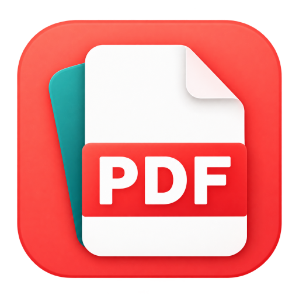

# ZhiXu PDF · 纸序 PDF

English · [简体中文](README.zh-CN.md)

**A free, open-source PDF toolbox for Windows.** Read and organize pages, annotate documents, clean scans, compare PDFs, print, and convert formats. Documents are processed locally, with no account required.

**[Download the latest release](https://github.com/d8349565/pdf-manage/releases/latest)** · [User guide (中文)](docs/USAGE.md) · [Changelog (中文)](CHANGELOG.md) · [Report an issue](https://github.com/d8349565/pdf-manage/issues)

## Quick Start

For Windows x64. Neither the installer nor the portable edition requires a separate Python installation.

1. On the release page, expand **Assets**, download `ZhiXuPDF-Setup.exe`, and run the installer. Alternatively, download `ZhiXuPDF-Portable-vX.Y.Z.zip`, extract the entire archive, and run `ZhiXuPDF.exe`. The **Source code** archives are for developers and cannot be run directly.
2. Drag a PDF, OFD, or image into the window, or open it from the **File** menu, to view its pages.
3. Switch to the page organizer to reorder, rotate, or copy pages. Choose **File → Save As** to create a new PDF. Open that copy to see the saved result.

For the portable edition, keep `_internal` and `portable.ini` beside the executable and extract everything into a separate, writable folder. Settings, caches, and the default OCR components are stored in its own `Data` folder. Explorer context-menu tools are optional; see the [portable edition notes (中文)](docs/USAGE.md#安装版与绿色版) before moving or deleting the folder.

**To recognize text in scans**, download the separate [OCR add-on](https://github.com/d8349565/pdf-manage/releases/latest/download/ZhiXuPDF-OCR-win-x64.zip) and import its ZIP from the text recognition (OCR) dialog in the **Scan** menu. Compatible components can be reused when updating the main app. [OCR setup and usage (中文)](docs/OCR.md)

This page describes the current source code. For a downloaded build, check its corresponding [release notes](https://github.com/d8349565/pdf-manage/releases).

## Interface languages

The app follows the system’s display language by default. English, Simplified Chinese, Traditional Chinese, Japanese, Korean, German, French, and Spanish are available. Choose **File → App settings → Interface language / Language** to select a language; the change takes effect on the next launch. Unsupported system languages use English. Some advanced tools and error messages may still appear in English or Simplified Chinese.

Translations are stored in shared text catalogues with checks for new messages and formatting placeholders. See [translation maintenance (中文)](docs/LOCALIZATION.md) to contribute or keep translations in sync with interface changes.

## Features

[](docs/images/feature-map.svg)

<details>
<summary>View the feature list in English</summary>

| Task | What you can do |
| --- | --- |
| Reading | Open PDF and OFD files in tabs; resume recent documents; use one-, two-, or four-page layouts; search, navigate bookmarks, adjust reading colors, and use full-screen or borderless mode |
| Page organization | Merge files or open tabs; split, extract, insert, drag to reorder, copy and paste pages; resize paper and split individual pages |
| Review and extraction | Highlight, add sticky notes, draw ink and shapes; insert text boxes and images; correct single-line text and styles; obscure areas, share annotated images, and extract page regions |
| PDF comparison (experimental) | Compare two saved PDFs, inspect text changes, and jump to the original pages; optionally check layout and graphics, with offline OCR available for scanned pages |
| Scanning | Clean backgrounds, crop paper, straighten pages, deskew scans, and remove colored handwriting; install offline OCR to search, copy text, and export editable documents |
| Conversion | Convert Word, images, and Markdown to PDF; export PDF to Word, Excel, TXT, and images |
| Printing | Print multiple pages per sheet, grayscale, single- or double-sided, and odd or even pages; impose folded booklets with left or right binding and separate front/back passes |
| Document tools | Compress PDFs and images; manage passwords and permissions; inspect signatures and protection; add page numbers, text/image watermarks, cross-page stamps, and full stamps on every page |

</details>

See the [user guide (中文)](docs/USAGE.md) for entry points, shortcuts, and limitations.

## Common Workflows

- **Merge open PDFs:** Use the merge-open-files command in the **Page** menu, select documents, arrange their order, and save the merged result. Unsaved page and annotation edits in the selected tabs are included; the original files and tabs are retained. The current source also offers a toolbar shortcut.
- **Compare document revisions:** Open the experimental two-PDF comparison from the **Document** menu, select or drop the old and new files, and inspect each difference against the original page. Save tab edits first for them to participate in the comparison. [Comparison guide (中文)](docs/PDFCOMPARE.md)
- **Remove colored handwriting from worksheets:** Open the colored-handwriting removal tool from **Scan**, choose red, blue, or a sampled color, mark content to protect, review the preview, and save a cleaned copy. No OCR add-on is required. [Instructions and limitations (中文)](docs/USAGE.md#去除彩色笔迹)
- **Extract parts of pages:** Open region extraction from **Document**, draw boxes on each page, and export them to a new PDF, arranged on A4 sheets or on separate pages. Existing rectangle annotations or page margins can also define the regions.
- **Adjust reading and app preferences:** Use reading settings in **View** to choose colors, layout, and page fitting. App settings in **File** provide shortcuts, storage management, and Explorer context-menu tools. Save settings in the current source let the first save create a new file (the default) or overwrite the source; after saving a copy, subsequent saves continue using that copy.

Enable the Explorer context-menu tools during installation to merge or split PDFs, combine images into a PDF, compress images, or convert Word/Markdown to PDF directly from Explorer. On Windows 11, these commands may appear under **Show more options**. Enable them inside the app when using the portable edition. [Explorer integration (中文)](docs/USAGE.md#安装与快捷入口)

## Video Demo

This 75-second demo was recorded with v0.7.5. It shows page organization, offline OCR, PDF-table export to Excel, and annotated-image sharing. Some screens differ from the current app; see the features above and the changelog for later changes.

https://github.com/user-attachments/assets/d4ac3a3d-a558-4e45-b97b-4613ed64aed1

[Download the 4K original (75 seconds)](https://github.com/d8349565/pdf-manage/releases/download/v0.7.5/zhixu-pdf-promo-75s-4k.mp4)

## Before You Use It

- **Saving and originals:** Page edits support undo, but drafts are not automatically recovered. Save your work regularly. Signed PDFs are protected in read-only mode; work on a saved copy of important files.
- **OCR and Word:** Check recognized amounts, identifiers, and conversion results. Handwriting recognition and exact reconstruction of arbitrary complex layouts are not supported. PDF-to-Word uses layout preservation by default and does not require Word; scanned pages require offline OCR. The additional Word reflow option and Word-to-PDF conversion require locally installed Microsoft Word. PDF import requires Word 2013 or later.
- **Comparison results:** PDF comparison is experimental. Review complex reflows, repeated clauses, and low-quality scans individually. Finding no differences does not prove that two documents are identical.
- **Colored-handwriting removal:** Intended for black text on white paper. Protect body text or stamps that share the selected color. Content hidden by opaque ink may not be recoverable. When an existing OCR layer is retained, erased answers may remain searchable and copyable. This tool is unsuitable for secure redaction.
- **Page processing:** Scan enhancement creates image pages without the original text layer and currently does not directly process pages containing annotations, links, or forms. Scan deskewing preserves the original images and text layer, while skipping pages with annotations, stamps, or forms. Splitting an individual page and extracting regions preserve only the appearance of annotations and forms; they can no longer be edited or filled, and links are no longer clickable. Select output protection again for encrypted sources. Try a few sheets before printing an entire booklet with manual duplex.
- **Watermarks and protection:** Only watermarks added by ZhiXu PDF can be managed. Cross-page stamps are images and do not provide digital signing or signature verification. Print and copy restrictions on PDFs that open without a password depend on the reader honoring them. Digitally signed OFD and some complex OFD files are unsupported; see [OFD compatibility (中文)](docs/USAGE.md#ofd-发票与回单).
- **Sensitive content:** Pixelated or blurred content may remain recognizable. Use a solid fill for sensitive areas and separately inspect other pages, attachments, and document metadata for the same information.

Documents are processed on your computer. Automatic update checks are enabled by default, run at most once every 24 hours, and can be disabled in **About**. Manual update checks, release notes, and component downloads need an internet connection; documents are not uploaded. Recent-reading history stays on your computer and can be removed or cleared from the **File** menu. It does not store opening passwords or unsaved edits.

## Troubleshooting

- **The portable edition will not start:** Extract the entire archive and keep `_internal` beside the EXE. Do not copy only `ZhiXuPDF.exe` or run it directly inside the ZIP.
- **OCR or Word is missing:** Import the separate OCR add-on to recognize scanned text. Word-to-PDF and Word reflow require locally installed Word; the default layout-preserving PDF-to-Word export does not.
- **Downloads are slow:** The **Lanzou Cloud** link in **About** opens a mirror and copies its access code. Exit the app before installing an update. Extract portable updates into a new folder.

## Feedback and Documentation

Report problems or suggest features through [GitHub Issues](https://github.com/d8349565/pdf-manage/issues). Include the app version, steps to reproduce, and error text.

The detailed guides are currently in Chinese: [User guide](docs/USAGE.md) · [OCR](docs/OCR.md) · [Compression](docs/COMPRESSION.md) · [PDF comparison](docs/PDFCOMPARE.md).

## Run from Source and Contribute

Use Windows x64 and 64-bit Python; Python 3.12 is recommended. From the repository root:

```powershell
python -m venv .venv
.venv\Scripts\python.exe -m pip install -r requirements.txt
.venv\Scripts\python.exe -m app
```

The ZhiXu PDF home screen should open. Choose the open-file action to begin. Installing dependencies for the first time requires an internet connection; the OCR add-on is still installed separately.

See the [development guide (中文)](docs/DEVELOPMENT.md) for building and checks, and the [repository maintenance guide (中文)](docs/REPOSITORY.md) for contribution scope. Issues and pull requests for fixes, documentation, and features are welcome. Keep real business documents, passwords, and personal settings out of public submissions.

## License

The project's own source code is licensed under [MIT](LICENSE). Third-party components retain their own licenses and copyrights. The Windows distribution combines components including PyMuPDF / MuPDF (AGPL-3.0) and PyQt6 (GPL-3.0), so the whole distribution is not covered solely by MIT.

Redistribution, whether paid or free and modified or unmodified, must comply with the applicable AGPL/GPL and other licenses. This includes retaining license and copyright notices and providing corresponding source code and build materials as required. These open-source licenses do not themselves prohibit commercial use. If you cannot comply with their terms, obtain the required alternative permissions from the relevant rights holders.

New builds include full license texts, upstream notices, and `SOURCES.txt`, which records actual dependency versions and source locations, under `_internal/licenses/`. Older packages missing these materials must be rebuilt; updating source documentation does not repair existing release assets. Download the matching application's **Source code** from the same-version [release page](https://github.com/d8349565/pdf-manage/releases); build instructions are in the [development guide (中文)](docs/DEVELOPMENT.md). See the [third-party licensing and distribution notes](packaging/licenses/THIRD-PARTY.txt) for more information.

### Acknowledgments

ZhiXu PDF builds on these open-source projects:

- [PyMuPDF](https://github.com/pymupdf/PyMuPDF) (AGPL-3.0) — PDF parsing, rendering, page organization, and encryption
- [PyQt6](https://www.riverbankcomputing.com/software/pyqt/) (GPL-3.0) — desktop interface and system printing
- [openpyxl](https://foss.heptapod.net/openpyxl/openpyxl) (MIT) — Excel export
- [Python-Markdown](https://github.com/Python-Markdown/markdown) (BSD-3-Clause) — Markdown layout and PDF conversion
- [pywin32](https://github.com/mhammond/pywin32) (PSF) — Explorer integration and native Windows interaction
- [RapidOCR](https://github.com/RapidAI/RapidOCR) (Apache-2.0) — optional offline OCR
