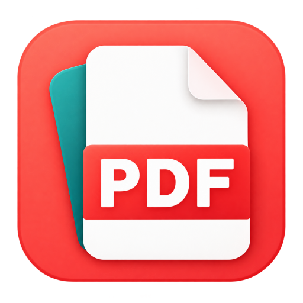

# 纸序 PDF

**免费、开源的 Windows PDF 工具箱。** 阅读、整理、批注、打印和格式转换，文档在本机处理，无需登录。

**[下载最新版](https://github.com/d8349565/pdf-manage/releases/latest)** · [使用指南](docs/USAGE.md) · [更新记录](CHANGELOG.md) · [问题反馈](https://github.com/d8349565/pdf-manage/issues)

## 快速开始

适用于 Windows x64。安装包和绿色版均无需自行安装 Python。

1. 在下载页面选择 `ZhiXuPDF-Setup.exe`，运行安装。也可选择绿色 ZIP，完整解压后运行其中的 `ZhiXuPDF.exe`。
2. 把 PDF、OFD 或图片拖进窗口，或从“文件 → 打开 PDF / OFD / 图片”选择文件，即可查看页面。
3. 切换到“整理页面”进行排序、旋转、复制或拆分；完成后点“文件 → 另存为”，保留原件并生成新文件。

绿色版请保留 `_internal` 和 `portable.ini`，解压到独立且可写的目录。设置、缓存与默认 OCR 组件保存在自己的 `Data` 中；右键菜单按需启用，移动或删除前的处理见[绿色版说明](docs/USAGE.md#安装版与绿色版)。

**需要识别扫描文字时**，另行下载 [OCR 增强包](https://github.com/d8349565/pdf-manage/releases/latest/download/ZhiXuPDF-OCR-win-x64.zip)，从“扫描 → 文字识别（OCR）”导入 ZIP。已有兼容组件可继续使用，无需随主程序更新重装。[安装与使用说明](docs/OCR.md)

## 功能

| 场景 | 主要能力 |
| --- | --- |
| 阅读 | PDF / OFD、多文件标签、单页 / 双页 / 四页布局、首尾页跳转、搜索与书签 |
| 整理 | 合并、拆分、提取、插页、拖动排序、复制粘贴、Ctrl+拖动复制、页面大小与单页分割 |
| 审阅 | 高亮、便签、画笔与图形批注，文本框、图片、单行文字修正，马赛克与批注图片分享 |
| 扫描 | 去底色、裁纸、拉正、扫描纠偏；安装离线 OCR 后可搜索、复制文字并导出可编辑文档 |
| 转换 | Word、图片、Markdown 转 PDF；PDF 转 Word、Excel、TXT 和图片 |
| 打印 | 多页合一、灰度、单双面，小册子对折排版、左右装订与正反面分批打印 |
| 文档工具 | PDF 与图片压缩、密码与权限保护、页码、文字 / 图片水印、骑缝章 |

具体入口、快捷键和操作限制见[使用指南](docs/USAGE.md)。

## 视频演示

75 秒了解页面整理、离线文字识别、PDF 表格转 Excel 和批注图片分享。

https://github.com/user-attachments/assets/d4ac3a3d-a558-4e45-b97b-4613ed64aed1

[下载 4K 原片（75 秒）](https://github.com/d8349565/pdf-manage/releases/download/v0.7.5/zhixu-pdf-promo-75s-4k.mp4)

## 使用前请注意

- **保存与原件**：页面修改可撤销，但没有自动恢复草稿，请及时保存。带签名的 PDF 以只读方式保护；重要文件建议另存副本后处理。
- **OCR 与 Word**：识别金额、编号和转换结果需要核对，暂不支持手写识别或任意复杂版面的精确恢复。PDF 转 Word 默认“保留原版式”，无需 Word，扫描页需要离线 OCR；更多选项可切换为“Word 重排”。Word 重排和 Word 转 PDF 依赖本机 Microsoft Word；PDF 导入需要 Word 2013 或更高版本。
- **页面处理**：扫描件增强会生成图片页面，不保留原文字层，含批注、链接或表单的页暂不直接处理；单页分割后的批注和表单只保留外观，链接不再可点击。小册子手动双面请先少量试打。
- **水印与保护**：只支持管理由纸序添加的水印；骑缝章是图片外观，不提供数字签名或验签。免密阅读的打印、复制限制依赖阅读器遵守；数字签名型及部分复杂 OFD 暂不支持，详见[格式边界](docs/USAGE.md#ofd-发票与回单)。
- **敏感内容**：像素块和模糊仍可能被辨认，敏感内容建议使用纯色遮盖。其他页面、附件和文档属性中的相同信息需另行检查。

文档不上传。自动检查更新默认开启，每天最多向 GitHub 查询一次版本，可在“关于”中关闭。

## 反馈与交流

使用问题或功能建议请提交 [GitHub Issues](https://github.com/d8349565/pdf-manage/issues)，附上软件版本、操作步骤和报错文字。

[使用指南](docs/USAGE.md) · [OCR 说明](docs/OCR.md) · [压缩说明](docs/COMPRESSION.md) · [开发说明](docs/DEVELOPMENT.md)

## 开源协议

本项目自有源码基于 [MIT 许可证](LICENSE) 开源。第三方组件保留各自的许可与版权；Windows 程序组合了 PyMuPDF / MuPDF（AGPL-3.0）、PyQt6（GPL-3.0）等组件，不能把整个发行包视为仅受 MIT 约束。

无论是否收费、是否修改，重新分发程序都须遵守适用的 AGPL/GPL 等许可，包括保留许可及版权声明，并按条款提供与程序匹配的对应源码和构建材料。商业使用本身不被这些开源许可禁止；如果无法遵守开源条款，应向相关权利人取得所需的其他授权。

新构建会将完整许可、上游声明和记录实际依赖版本及源码入口的 `SOURCES.txt` 放入 `_internal/licenses/`；缺少这些材料的旧包需要重新构建，源码说明更新不会自动补齐旧附件。正式版应用源码可从同一版本的 [Release 页面](https://github.com/d8349565/pdf-manage/releases) 下载 Source code，构建方法见 [开发说明](docs/DEVELOPMENT.md)。更多说明见 [开源许可与分发说明](packaging/licenses/THIRD-PARTY.txt)。

### 感谢开源项目

纸序 PDF 站在巨人的肩膀上，特别感谢以下优秀的开源项目：

- [PyMuPDF](https://github.com/pymupdf/PyMuPDF) (AGPL-3.0) — PDF 页面解析、渲染、整理与加密
- [PyQt6](https://www.riverbankcomputing.com/software/pyqt/) (GPL-3.0) — 桌面图形界面与系统打印
- [openpyxl](https://foss.heptapod.net/openpyxl/openpyxl) (MIT) — 表格导出为 Excel
- [Python-Markdown](https://github.com/Python-Markdown/markdown) (BSD-3-Clause) — Markdown 排版转 PDF
- [pywin32](https://github.com/mhammond/pywin32) (PSF) — Windows 右键菜单与系统原生交互
- [RapidOCR](https://github.com/RapidAI/RapidOCR) (Apache-2.0) — 离线文字识别（可选组件）
