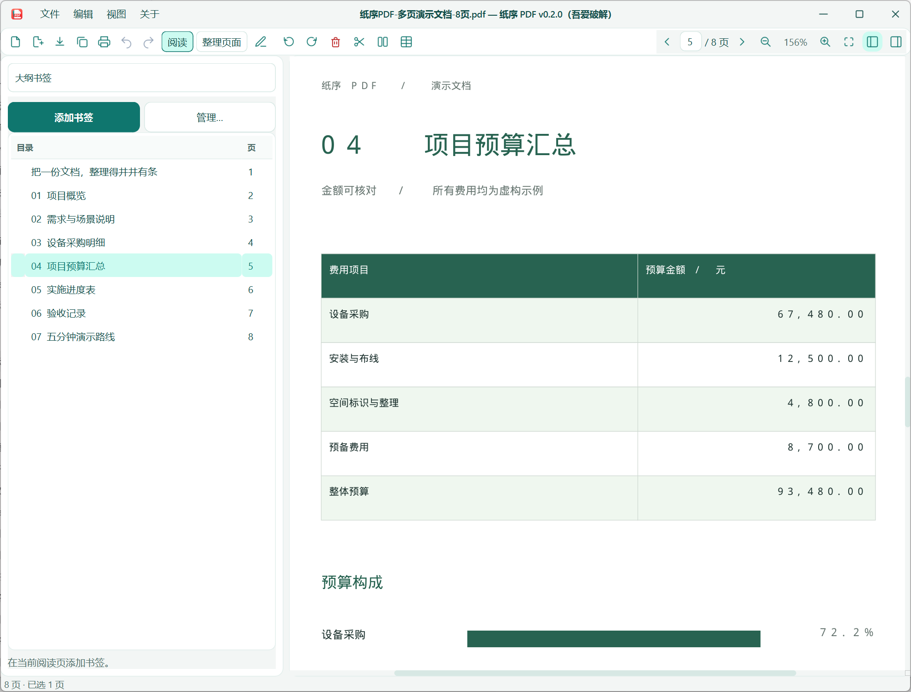
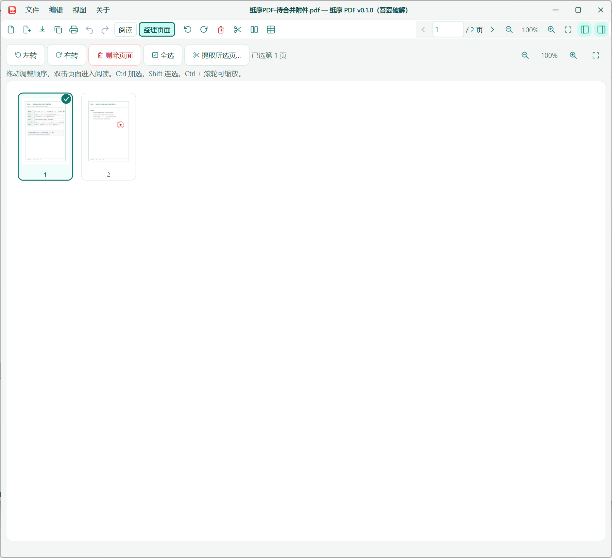
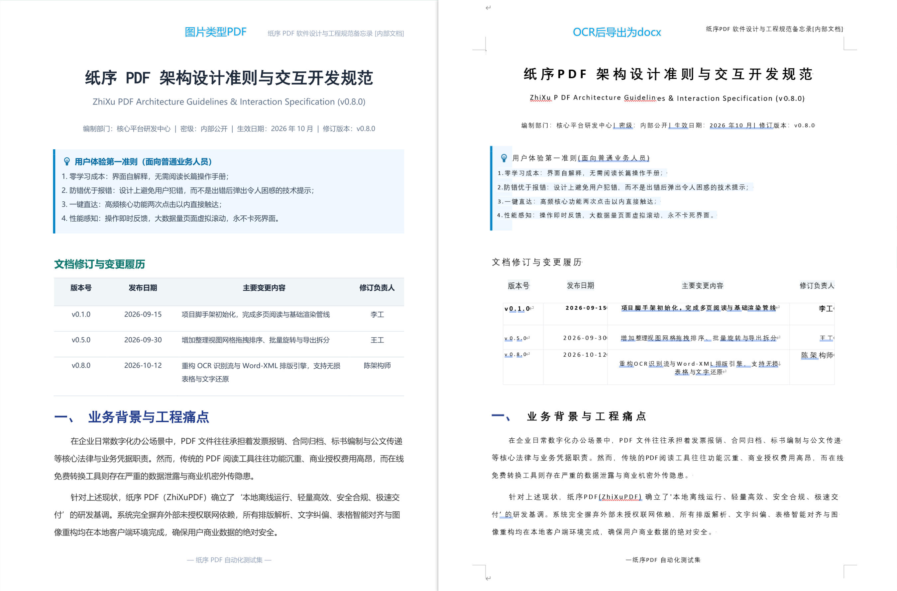
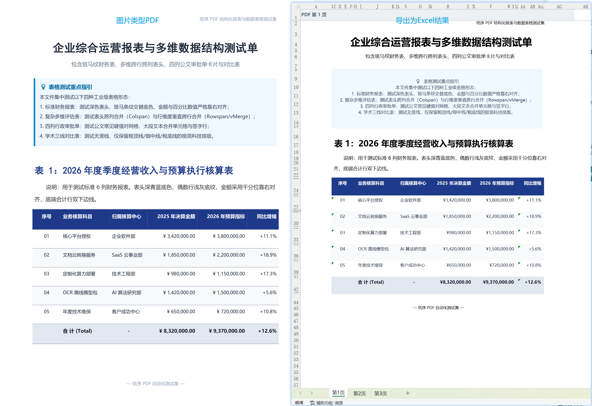
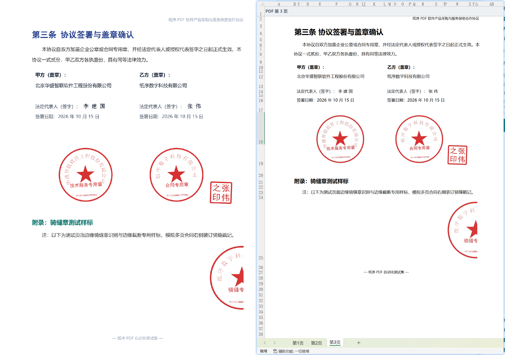

# 纸序 PDF

**免费、开源、离线的 Windows PDF 工具箱。** 阅读、整理、打印、压缩加密、格式转换，一个窗口搞定。

文件只在你的电脑上处理，不上传文档、不用登录。默认不自动联网；手动检查更新或主动开启自动检查时，会向 GitHub 查询版本。

[更新记录](CHANGELOG.md)

## 快速开始

1. 到 [Releases](https://github.com/d8349565/pdf-manage/releases/latest) 下载并运行 `ZhiXuPDF-Setup.exe`。下载[OCR包](https://github.com/d8349565/pdf-manage/releases/download/v0.5.6/ZhiXuPDF-OCR-win-x64.zip)在软件中导入才能使用OCR功能。
2. 把 PDF 拖进窗口。
3. 在“阅读”里看，在“整理”里改，完成后点“保存”；想保留原文件就点“另存为”。

> 如果想自己运行源码或参与开发，请参考 [开发说明](docs/DEVELOPMENT.md)。

## 功能

| 场景 | 能做什么 |
| --- | --- |
| 阅读与目录 | 连续翻页、缩放、跳转；全文搜索、匹配高亮与上一处/下一处；侧栏大纲书签与层级编辑 |
| 审阅与修正 | 高亮、下划线、便签、画笔、图形批注；页面多行文本框、字体/字号/颜色设置；单行文字修正与撤销 |
| 整理 | 合并、插入页面；每页、每 N 页或按范围拆分；提取页面；拖动排序、旋转、删除；支持撤销 |
| 打印 | 后台预览与发送、进度和取消；页码、纸张、份数、单双面；每面 1/2/4/6/9/16 页排版、顺序和边框 |
| 水印 | 文字/图片水印，位置、大小、透明度、旋转和平铺；移除纸序添加的水印，支持撤销 |
| 压缩与加密 | 缩小体积；打开密码、免密阅读权限保护或双重保护 |
| 页码 | 添加可见页码、跳过封面、奇偶页外侧；阅读器页标签与批量输出 |
| 文字识别 | 独立安装离线 OCR 增强包，扫描 PDF 转为可搜索、可框选复制的 PDF 副本 |
| 转换 | 图片与 PDF 互转；PDF 表格转 Excel、文字转 TXT；Word 与 PDF 多文件互转；Markdown 转 PDF |

## 使用前请注意

- **整理放大预览**：按住 Alt 悬停在页面卡片上可查看清晰预览，松开或移出即关闭；也可右键选择“放大预览”，按 Esc 关闭。拖动排序时不弹出预览。
- **页面文本框**：在带中文标签的审阅栏选择“文本框”，画出范围后直接在页面内输入多行文字；右下角从下拉列表选择字体、字号，并设置颜色。Enter 换行，点击框外或 Ctrl+Enter 完成，Esc 取消；双击已有文本框重新编辑，悬浮后可移动或删除。“改原文”用于修正已有单行文字，与新建文本框分开。
- **打印排版**：“每面排列”控制一面纸放几页；双面打印先排满正面再排背面。先横向/先纵向控制格子顺序，“相反页序”先反转所选 PDF 页序再排版。最后一面不足的格子留空。
- **水印**：从“组织 → 水印”打开，左侧调整设置，右侧自动更新预览；可直接拖动水印定位，平铺时整体移动图案，方向键微调，Shift 加大步长，拖动中 Esc 恢复起点，“复位”恢复居中。大小、旋转与不透明度复用页面底图，文字或图片素材在独立进程生成。应用到指定范围后支持撤销；移除仅限纸序添加的水印，保存重开也可移除。
- **PDF 右键入口**：安装时勾选 PDF 右键入口，可从资源管理器直接打开拆分设置或载入多个 PDF 合并。Windows 11 在“显示更多选项”中使用；先检查页面顺序，再保存为新文件。
- **Markdown 右键入口**：安装时勾选 Markdown 右键入口，右键 `.md` 或 `.markdown` 文件选择“转换为 PDF”，即可打开已填好文件的转换窗口。Windows 11 在“显示更多选项”中使用。
- **转换入口**：“转换”菜单上组为 Word、图片、Markdown 转入 PDF，下组为 PDF 转 Word、Excel、TXT、图片。转换窗口支持多文件拖入，默认保留原文件，已有输出默认跳过。
- **PDF 转图片版**：默认使用 200 DPI、JPEG 质量 90，兼顾清晰度与体积；需要更小文件可选择 150 DPI。200/300 DPI 无损图片适合优先保留像素细节，处理扫描件或带水印页面时可能明显增大文件。转换会固化水印、批注与表单外观，原件保留。
- **压缩 PDF**：默认“均衡”，适度压缩图片以兼顾清晰度与体积；也可选择无损优化、高质量、适合外发、小体积，或自定义图片分辨率、质量及灰度。文字与矢量内容保留，黑白图片不降采样。先查看前后大小和页面预览，再另存结果；图片重编码未进一步缩小时自动保留更小的无损结果。
- **页码输入**：英文逗号、中文逗号以及中英文分号均可分隔，例如 `1-3，5；7-9`。
- **插入页面**：在整理工具栏或编辑菜单点击“插入页面…”。已选页面时插入在最后一个所选页后，未选中时追加到末尾；插入后选中新页面，支持撤销、重做，保存时选择新文件以保留来源。
- **按页数拆分**：在拆分工具中选择“每几页一个文件”，输入页数后可看到预计文件数量；最后一个文件保留剩余页面。
- **离线 OCR**：基础安装包不包含推理库或模型。在“组织 → 文字识别”中安装与主程序对应的独立 OCR ZIP，之后无需 Python 和网络即可识别。输出新 PDF，支持页码范围、跳过已有文字与取消；金额、编号及识别结果请核对。[安装与使用说明](docs/OCR.md)
- **表格转 Excel**：支持电子 PDF 和完成 OCR 的扫描表格。线框、稳定对齐与浅色底纹用于推断行列；不规则或无明确证据的表格仍需核对。
- **Word 与 PDF 互转**：扫描 PDF 通过离线组件自动识别；已有 OCR 文字层可直接生成可编辑 DOCX，无需 Microsoft Word。普通电子 PDF 重排和 Word 转 PDF 使用本机 Microsoft Word，PDF 导入需要 Word 2013 或更高版本。只有需要 Word 导入时才询问首次确认设置。复杂版式仍需核对，加密文件需先另存解密副本。
- **Markdown 转 PDF**：使用 UTF-8 文件，支持常规 Markdown 和中文，仅加载同目录及子目录的本地图片。公式和 Mermaid 按源码显示。
- **文字修正**：支持单行横排可见文字的原处修改，按 Enter 或确认图标应用，Esc 取消；右侧空间充足时可输入更长文字。应用时会实际移除旧字，写入失败保留原文和输入内容。选区与图片、表单、链接或隐藏文字重叠时拒绝修改，复杂段落请转 Word 编辑。
- **批注移动**：悬浮矩形框或便签后，拖动浮层的移动按钮即可实时预览落点；也可点击移动按钮再选位置。松手应用，Esc 取消，Ctrl+Z 撤销。
- **权限保护**：免密阅读的打印和复制限制依赖阅读器遵守，不能保证绝对防复制。
- **全文搜索**：点击顶部放大镜或按 Ctrl+F，输入关键词；Enter / F3 跳到下一处，Shift+Enter / Shift+F3 跳到上一处，Esc 关闭。搜索带文字层的页面，支持中文及英文字母大小写不敏感匹配；纯扫描图片需 OCR。长文档显示搜索进度，最多显示前 10,000 个匹配区域。
- **框选复制**：在阅读区拖动框选文字，按 Ctrl+C 或右键复制；Alt+拖动移动页面。电子文字和 OCR 文字使用同一交互，受复制权限限制。
- **暂不支持**：完整段落编辑、正文目录生成、手写识别及任意复杂版面的精确恢复。
- **请及时保存**：页面修改可撤销，但没有自动恢复草稿。带签名的文件会以只读方式保护。

## 反馈与交流

如果在使用中遇到问题或有改进建议，欢迎提交 [GitHub Issues](https://github.com/d8349565/pdf-manage/issues)。如果觉得好用，欢迎点亮 ⭐ **Star** 支持一下！

## 开源协议

本项目源码基于 [MIT 许可证](LICENSE) 开源，你可以自由使用、修改或分享。

> **友情提示**：直接下载运行的 Windows 安装包和可执行文件中，集成了 **PyMuPDF**（AGPL-3.0）与 **PyQt6**（GPL-3.0）。如果你打算把打包后的程序改动并重新发布给他人，按照它们的协议要求同样需要公开源码；若计划用于闭源商业软件，请记得单独联系原作者购买商业授权。

### 感谢开源项目

纸序 PDF 站在巨人的肩膀上，特别感谢以下优秀的开源项目：

- [PyMuPDF](https://github.com/pymupdf/PyMuPDF) (AGPL-3.0) — PDF 页面解析、渲染、整理与加密
- [PyQt6](https://www.riverbankcomputing.com/software/pyqt/) (GPL-3.0) — 桌面图形界面与系统打印
- [openpyxl](https://foss.heptapod.net/openpyxl/openpyxl) (MIT) — 表格导出为 Excel
- [Python-Markdown](https://github.com/Python-Markdown/markdown) (BSD-3-Clause) — Markdown 排版转 PDF
- [pywin32](https://github.com/mhammond/pywin32) (PSF) — Windows 右键菜单与系统原生交互
- [RapidOCR](https://github.com/RapidAI/RapidOCR) (Apache-2.0) — 离线文字识别（可选组件）
