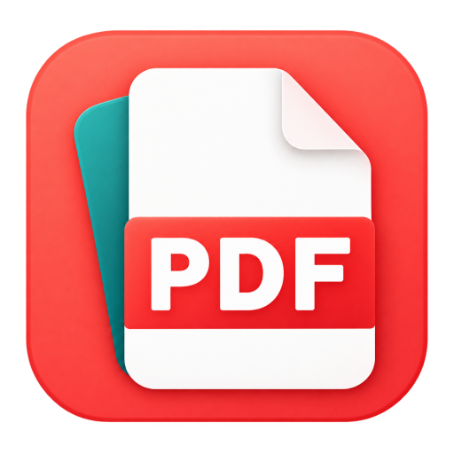

# 纸序 PDF

[English](README.md) · 简体中文

**免费、开源的 Windows PDF 工具箱。** 用于日常阅读、页面整理、批注、扫描件清理、文档对比、打印和格式转换，文档在本机处理，无需登录。

**[下载最新版](https://github.com/d8349565/pdf-manage/releases/latest)** · [使用指南](docs/USAGE.md) · [更新记录](CHANGELOG.md) · [问题反馈](https://github.com/d8349565/pdf-manage/issues)

## 快速开始

适用于 Windows x64。安装包和绿色版均无需自行安装 Python。

1. 在下载页面的附件（Assets）中选择 `ZhiXuPDF-Setup.exe`，运行安装。也可选择 `ZhiXuPDF-Portable-vX.Y.Z.zip` 绿色版，完整解压后运行其中的 `ZhiXuPDF.exe`；`Source code` 是源码，不是可直接运行的程序。
2. 把 PDF、OFD 或图片拖进窗口，或从“文件 → 打开 PDF / OFD / 图片”选择文件，即可查看页面。
3. 切换到“整理页面”调整顺序、旋转或复制页面；完成后点“文件 → 另存为”，保存为新 PDF。以后打开这个副本，即可看到整理后的结果。

绿色版请保留 `_internal` 和 `portable.ini`，解压到独立且可写的目录。设置、缓存与默认 OCR 组件保存在自己的 `Data` 中；右键菜单按需启用，移动或删除前的处理见[绿色版说明](docs/USAGE.md#安装版与绿色版)。

**需要识别扫描文字时**，另行下载 [OCR 增强包](https://github.com/d8349565/pdf-manage/releases/latest/download/ZhiXuPDF-OCR-win-x64.zip)，从“扫描 → 文字识别（OCR）”导入 ZIP。已有兼容组件可继续使用，无需随主程序更新重装。[安装与使用说明](docs/OCR.md)

本页按当前源码说明功能，下载版以对应的 [Release 说明](https://github.com/d8349565/pdf-manage/releases)为准。

## 界面语言

默认跟随系统显示语言，支持简体中文、英语、繁体中文、日语、韩语、德语、法语和西班牙语。可从“文件 → 应用设置 → 界面语言 / Language”手动选择，下次启动时生效；其他系统语言使用英语。部分高级工具和错误提示仍可能显示英语或简体中文。

译文集中维护，可检查新增文本和格式占位符，后续更新时按[多语言维护说明](docs/LOCALIZATION.md)同步。

## 功能

[](docs/images/feature-map.svg)

<details>
<summary>查看文字版功能清单</summary>

| 场景 | 主要能力 |
| --- | --- |
| 阅读 | PDF / OFD、多文件标签、最近阅读与续读、单页 / 双页 / 四页布局、搜索与书签、阅读配色、全屏与无边框模式 |
| 整理 | 合并磁盘文件或已打开标签、拆分、提取、插页、拖动排序、页面复制粘贴、调整纸张尺寸与单页分割 |
| 审阅与摘录 | 高亮、便签、画笔与图形批注，文本框、图片、单行文字及样式修正，马赛克、批注图片分享与区域摘录 |
| 文档对比（实验） | 对比两份已保存的 PDF，查看文字变化并定位原页；可选版式与图形检查，扫描页可借助离线 OCR |
| 扫描 | 去底色、裁纸、拉正、扫描纠偏、去除彩色笔迹；安装离线 OCR 后可搜索、复制文字并导出可编辑文档 |
| 转换 | Word、图片、Markdown 转 PDF；PDF 转 Word、Excel、TXT 和图片 |
| 打印 | 多页合一、灰度、单双面、奇偶页筛选，小册子对折排版、左右装订与正反面分批打印 |
| 文档工具 | PDF 与图片压缩、密码与权限保护、签名与保护信息查看、页码、文字 / 图片水印、骑缝章与每页完整盖章 |

</details>

具体入口、快捷键和操作限制见[使用指南](docs/USAGE.md)。

## 常用入口

- **合并已打开的 PDF**：从“页面 → 合并已打开文件”选择文件、调整顺序，再点“合并并另存”。会使用标签内尚未保存的页面和批注修改，原文件与原标签保留；当前源码也可从顶部工具栏进入。
- **对比新旧文档**：从“文档 → 两份 PDF 对比（实验）”选择或拖入旧版、新版，逐项查看差异并回到原页核对。当前标签中的修改需先保存，才会参与对比。[对比说明](docs/PDFCOMPARE.md)
- **清理试卷或讲义笔迹**：从“扫描 → 去除彩色笔迹”选择红色、蓝色或取色，标记需要保留的内容，核对预览后另存清理副本；无需 OCR 增强包。[操作与限制](docs/USAGE.md#去除彩色笔迹)
- **摘录部分页面内容**：从“文档 → 区域摘录”逐页画框，可拼到 A4 或按区域独立分页，导出新 PDF；也可使用已有矩形批注或页边距。
- **调整阅读与操作习惯**：从“视图 → 阅读设置”选择阅读配色、布局和适配方式；从“文件 → 应用设置”进入快捷键管理、存储管理或右键快捷工具。当前源码的“保存设置”可选择首次保存时另存新文件（默认）或覆盖源文件，另存后继续保存会沿用副本位置。

安装时勾选“启用右键快捷工具”，还可从资源管理器直接合并或拆分 PDF、将多张图片合并为 PDF、压缩图片以及将 Word / Markdown 转为 PDF。Windows 11 的入口可能位于“显示更多选项”；绿色版需在软件内自行启用。[右键入口说明](docs/USAGE.md#安装与快捷入口)

## 视频演示

v0.7.5 录制的 75 秒演示，展示页面整理、离线文字识别、PDF 表格转 Excel 和批注图片分享。部分界面与当前版本不同，新功能见上方说明及更新记录。

https://github.com/user-attachments/assets/d4ac3a3d-a558-4e45-b97b-4613ed64aed1

[下载 4K 原片（75 秒）](https://github.com/d8349565/pdf-manage/releases/download/v0.7.5/zhixu-pdf-promo-75s-4k.mp4)

## 使用前请注意

- **保存与原件**：页面修改可撤销，但没有自动恢复草稿，请及时保存。带签名的 PDF 以只读方式保护；重要文件建议另存副本后处理。
- **OCR 与 Word**：识别金额、编号和转换结果需要核对，暂不支持手写识别或任意复杂版面的精确恢复。PDF 转 Word 默认“保留原版式”，无需 Word，扫描页需要离线 OCR；更多选项可切换为“Word 重排”。Word 重排和 Word 转 PDF 依赖本机 Microsoft Word；PDF 导入需要 Word 2013 或更高版本。
- **对比结果**：PDF 对比仍为实验功能，复杂重排、重复条款和低清扫描需逐项核对；未检出变化不能视为两份文件完全一致。
- **彩色笔迹清理**：适合黑字白纸，同色正文或印章需要标记保护；被不透明笔迹遮住的内容不能保证恢复。保留旧 OCR 文字层时，擦掉的答案可能仍可搜索、复制，此功能不用于安全脱敏。
- **页面处理**：扫描件增强会生成图片页面，不保留原文字层，含批注、链接或表单的页暂不直接处理。扫描纠偏保留原始图片和已有文字层，含批注、印章或表单的页会跳过。单页分割和区域摘录中的批注、表单只保留外观，不再可编辑或填写，链接不再可点击；加密来源需重新选择输出保护。小册子手动双面请先少量试打。
- **水印与保护**：只支持管理由纸序添加的水印；骑缝章是图片外观，不提供数字签名或验签。免密阅读的打印、复制限制依赖阅读器遵守；数字签名型及部分复杂 OFD 暂不支持，详见[格式边界](docs/USAGE.md#ofd-发票与回单)。
- **敏感内容**：像素块和模糊仍可能被辨认，敏感内容建议使用纯色遮盖。其他页面、附件和文档属性中的相同信息需另行检查。

文档处理在本机完成。自动检查更新默认开启，每 24 小时最多自动检查一次，可在“关于”中关闭；手动检查更新、获取发布说明及下载组件需要联网，不上传文档。最近阅读记录保存在本机，可从“文件 → 最近阅读记录”移除或清空，不记录打开密码和未保存修改。

## 常见问题

- **绿色版无法启动**：确认已经完整解压，并保留 EXE 旁的 `_internal`；不要只复制 `ZhiXuPDF.exe`，也不要直接在 ZIP 中运行。
- **提示缺少 OCR 或 Word**：扫描文字识别需要单独导入 OCR 增强包；Word 转 PDF 和“Word 重排”需要本机 Word，默认的 PDF 转 Word“保留原版式”无需 Word。
- **下载较慢**：可从软件的“关于 → 蓝奏云”打开备用下载入口，点击时会复制提取密码。安装更新前先退出软件；绿色版更新请解压到新文件夹。

## 反馈与交流

使用问题或功能建议请提交 [GitHub Issues](https://github.com/d8349565/pdf-manage/issues)，附上软件版本、操作步骤和报错文字。

[使用指南](docs/USAGE.md) · [OCR 说明](docs/OCR.md) · [压缩说明](docs/COMPRESSION.md) · [PDF 对比说明](docs/PDFCOMPARE.md)

## 从源码运行与参与开发

使用 Windows x64 和 64 位 Python，推荐 Python 3.12。在源码根目录执行：

```powershell
python -m venv .venv
.venv\Scripts\python.exe -m pip install -r requirements.txt
.venv\Scripts\python.exe -m app
```

成功后会打开纸序 PDF 首页，可从“打开文件”开始使用。首次安装依赖需要联网，OCR 增强包仍需单独安装。

构建和检查方法见[开发说明](docs/DEVELOPMENT.md)，提交范围见[仓库维护说明](docs/REPOSITORY.md)。欢迎通过 Issue 或 Pull Request 反馈问题、改进文档与功能；公开提交请勿包含真实业务文档、密码或个人配置。

## 开源协议

本项目自有源码基于 [MIT 许可证](LICENSE) 开源。第三方组件保留各自的许可与版权；Windows 程序组合了 PyMuPDF / MuPDF（AGPL-3.0）、PyQt6（GPL-3.0）等组件，不能把整个发行包视为仅受 MIT 约束。

无论是否收费、是否修改，重新分发程序都须遵守适用的 AGPL/GPL 等许可，包括保留许可及版权声明，并按条款提供与程序匹配的对应源码和构建材料。商业使用本身不被这些开源许可禁止；如果无法遵守开源条款，应向相关权利人取得所需的其他授权。

新构建会将完整许可、上游声明和记录实际依赖版本及源码入口的 `SOURCES.txt` 放入 `_internal/licenses/`；缺少这些材料的旧包需要重新构建，源码说明更新不会自动补齐旧附件。正式版应用源码可从同一版本的 [Release 页面](https://github.com/d8349565/pdf-manage/releases) 下载 Source code，构建方法见 [开发说明](docs/DEVELOPMENT.md)。更多说明见 [开源许可与分发说明](packaging/licenses/THIRD-PARTY.txt)。

### 感谢开源项目

纸序 PDF 站在巨人的肩膀上，特别感谢以下优秀的开源项目：

- [PyMuPDF](https://github.com/pymupdf/PyMuPDF) (AGPL-3.0) — PDF 页面解析、渲染、整理与加密
- [PyQt6](https://www.riverbankcomputing.com/software/pyqt/) (GPL-3.0) — 桌面图形界面与系统打印
- [openpyxl](https://foss.heptapod.net/openpyxl/openpyxl) (MIT) — 表格导出为 Excel
- [Python-Markdown](https://github.com/Python-Markdown/markdown) (BSD-3-Clause) — Markdown 排版转 PDF
- [pywin32](https://github.com/mhammond/pywin32) (PSF) — Windows 右键菜单与系统原生交互
- [RapidOCR](https://github.com/RapidAI/RapidOCR) (Apache-2.0) — 离线文字识别（可选组件）
