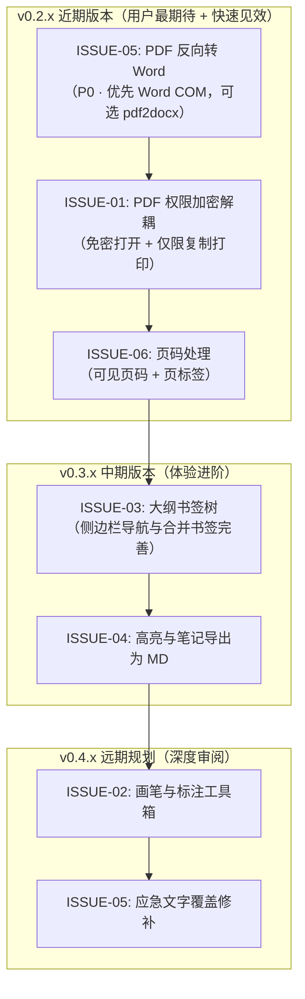

# 纸序 PDF · 用户需求与功能建议整理清单 (Issues & Feature Requests)

> **v0.2.0 本轮落实说明**：下文保留原始反馈及调研记录。经用户确认，Markdown 的实际方向为 **Markdown → PDF**，本轮不实现 PDF → Markdown；目录先做侧栏大纲，不生成正文目录页。原文修正采用实际移除旧字并插入新字的方式，不采用仅盖白块的方案。已实现免密权限保护、Word 双向批量转换、Markdown 转 PDF、可见页码与页标签、侧栏书签、高亮备注与图形批注、单行原文修正；真实 Word、性能和打包验收按验证结果记录，不将代码完成等同于全部环境验收。

本文档整理收集了用户针对“纸序 PDF”提出的使用体验反馈、功能缺陷与迭代建议。每个需求均包含**用户原声**、**场景与痛点分析**、**概念与含义深度剖析**、**技术可行性与实现构想**，以及遵循产品设计原则的**交互设计与优先级建议**。

---

## 需求概览与优先级矩阵

| 编号 | 需求名称 | 核心诉求 | 涉及模块 | 实现复杂度 | 优先级 | 建议规划 |
| :--- | :--- | :--- | :--- | :--- | :--- | :--- |
| **ISSUE-05** | **反向转 Word 与内容编辑** | 将 PDF 转换为可编辑的 Word (.docx)；提供轻量级文字修改 | 格式转换、外部引擎集成 | 高（编辑）/ 中（转Word） | **P0（用户最期待）** | v0.2.x（转 Word）；编辑远期 |
| **ISSUE-01** | **PDF 权限加密解耦** | 支持“免密码直接打开阅读，但限制打印与复制文本” | 导出与安全 (`exportdialogs`, `pdfio`) | 中低（两处校验 + 文案 + 测试） | **P1（高优）** | v0.2.x 小版本 |
| **ISSUE-06** | **页码编排与批量处理** | 可见页码（格式、位置、跳过封面、起始页码）与阅读器页标签 | 页面整理、批量输出 | 低 ~ 中 | **P1（高优）** | v0.2.x 页面工具 |
| **ISSUE-03** | **添加与管理目录 (TOC)** | 大纲侧栏（查看、编辑、跳转）；合并书签用文件名命名（保留书签底层已具备） | 侧边栏大纲、`pdfstructure` | 中 | **P1（高优）** | v0.3.x 大纲导航 |
| **ISSUE-04** | **高亮、备注与转 Markdown** | 选中文本高亮、添加图释便签，并将批注笔记或全文导出为 MD | 文本选择、格式转换 | 中 | **P2（排期）** | v0.3.x 知识管理 |
| **ISSUE-02** | **画笔与图形标注** | 自由手绘线条（签名/圈划）及矩形/箭头等批注图形 | 阅读视图、绘图图层 | 中 | **P2（排期）** | v0.4.x 审阅功能 |

---

## 详细需求整理与技术分析

---

### ISSUE-01: PDF 权限保护解耦（支持“免密打开 + 仅限打印复制”模式）

#### 1. 用户原声
> “我平时使用PDF加密，都是这样设置：能正常打开，不需要密码，但是限制打印和复制，需要加密。\
> 你这个软件设置的是必须先设置打开密码，然后才能限制打印和复制，这样使用起来就很不方便。\
> 当然你这个优点是可以设置两个密码，不同的密码不同的权限，但不能直接打开就限制了传输和分发，是吧”

#### 2. 场景与痛点分析
- **典型业务场景**：对外公开发布白皮书、产品手册、报价单、对外合同草案或课件资料。
- **痛点**：发件人希望接收方**双击直接无感打开阅读**（不需要分发和沟通打开密码），但防止接收方随意一键全选复制内容用于剽窃，或限制高精度打印。
- **当前设计缺陷**：打开密码被强制必填，共有**两处**校验：
  1. 界面层 [`exportdialogs.py`](file:///d:/code/pdf-manage/app/exportdialogs.py) 的 `EncryptionDialog.validate()`：`if not self.password.text()` → “请输入打开密码…”；
  2. 数据层 [`pdfio.py`](file:///d:/code/pdf-manage/app/pdfio.py) 的 `EncryptionOptions.validate()`：`not self.user_password` 时抛出“打开密码须为 1～40 个字符…”。

  导致用户想要“限制打印/复制”时，被迫加一个打开密码，违背了开放分发且保护权限的初衷。

#### 3. 技术可行性与规范解析
- **PDF 官方规范支持**：PDF 标准（ISO 32000）将保护密码清晰划分为两个独立角色：
  1. **User Password（用户密码 / 打开密码）**：用于解密并打开文档。**允许为空字符串 `""`**。
  2. **Owner Password（所有者密码 / 管理密码 / 权限密码）**：用于控制权限（`permissions` 位掩码）。设置后，免密打开的用户受权限位约束；输入 Owner Password 才能解除限制。
- **PyMuPDF 支持（已实测，1.28.2）**：`doc.save(..., user_pw="", owner_pw="管理密码", permissions=...)` 可正常保存；重新打开无需密码，`permissions` 中的打印、复制位为关闭，输入管理密码后 `authenticate` 返回 4（所有者）。无需新增依赖。
- **需要同步处理的影响**：
  - 免密文件打开后，`authenticate("")` 返回 2（用户级），`owner_authenticated` 为 False；如果同时限制了“修改/整理页面”，纸序 PDF 会按现有逻辑以只读方式打开。这是合理的，但需在提示文字中说明，避免用户误以为文件损坏；
  - 输出后的“重新打开核对”流程（`pdfio.py` 保存后校验）使用空密码验证，需补充测试覆盖。
- **安全边界（必须明确告知用户）**：只设管理密码、不设打开密码时，文件的解密密钥可由空密码得到，**任何第三方工具都能解密并移除打印/复制限制**。它能拦住普通读者的随手复制，不能防止有意破解。界面应写明“仅限制普通阅读器的打印与复制，不能保证绝对防复制”；需要真正保密请使用打开密码。

#### 4. 改进方案与 UX 交互
- **界面交互优化**（遵循“防错优于报错”与“渐进披露”）：
  - 拆分保护类型，改为清晰的单选或场景化选项：
    - **模式 A：仅限制打印与复制（免密打开）**：无需输入打开密码，只需设置“权限管理密码”，并附带上述安全边界提示；
    - **模式 B：仅限制文档打开**：必须输入打开密码方可阅读；
    - **模式 C：双重保护（打开 + 独立权限管理）**：对应现有行为，既防未授权打开，又限制复制打印。
  - 现有“高级选项 · 打印与复制权限”折叠在加密对话框内，不易被发现；模式 A 应直接作为一级选项展示。
  - “打开密码”不再作为硬性必填；仅当未选择任何保护方式（未设打开密码，也未限制权限）时，才提示“请选择至少一种保护方式”。
- **实现复杂度**：中低。需同时修改对话框校验、`EncryptionOptions.validate()`、提示文案并补测试，不是只改一处。

---

### ISSUE-02: 页面标注与手绘画笔工具

#### 1. 用户原声
> “建议增加标注和画笔。”

#### 2. 场景与痛点分析
- **典型业务场景**：合同/公文审阅、设计图纸校对、试卷/作业批改、电子文档手写签名。
- **痛点**：当前软件以“查看”和“页面增删排序”为主，缺乏交互式批注能力。用户需要临时圈出重点、划线、手绘箭头或签名字样时，必须跳出到其他重量级软件中处理。

#### 3. 技术可行性与实现构想
- **PyMuPDF Annotation API 支持**：
  - 手绘笔迹：`page.add_ink_annot(stroke_list)`，原生支持笔画点集。
  - 几何标注：`page.add_rect_annot(rect)`（矩形）、`page.add_circle_annot(rect)`（椭圆）、`page.add_line_annot(p1, p2)`（线条/箭头）。
  - 属性配置：支持自定义描边颜色、填充颜色、笔画粗细、透明度（Opacity）。
- **前端与交互实现**：
  - 在现有阅读界面上层建立透明交互画布（`AnnotationCanvas`），响应鼠标事件：
    - `mousePressEvent`：记录起点；
    - `mouseMoveEvent`：收集平滑轨迹点并绘制实时预览；
    - `mouseReleaseEvent`：生成临时矢量标注图元，提交至工作区撤销栈。
  - 提供轻量工具条：【画笔】【矩形框】【箭头】【橡皮擦/撤销】【颜色盘】【线宽】。

---

### ISSUE-03: 添加与管理目录功能（概念深入剖析）

#### 1. 用户原声
> “希望有添加目录 的功能（这个具体指的是什么意思？）”

#### 2. “具体指的是什么意思？”——深入剖析与概念澄清
在 PDF 相关软件与日常用户表达中，“添加目录”通常混杂着两种截然不同的诉求，需要向用户和团队做清晰界定：

| 维度 | 概念 A：文档大纲 / 书签树 (Bookmarks / Outline) ⭐最核心诉求 | 概念 B：可视正文目录页 (Table of Contents Page) |
| :--- | :--- | :--- |
| **呈现形式** | 阅读器**左侧导航栏**中的可折叠树状结构（第1章、1.1节等）。点击目录项，主视图直接跳转到对应页面。 | 插入在文档正文开头（如封面后）的一页或几页纸，包含文字排版：“第一章 概述 ...... 1”。 |
| **载体机制** | PDF 内部的元数据大纲结构（`catalog/Outlines`），不占用正文页面，不影响纸质打印排版。 | 正文中的实际页面，占用物理页码，可打印。页面上的标题带有超链接跳转（Link Annotation）。 |
| **用户真实诉求** | 1. 扫描书本或多源汇编的 PDF 没有侧边栏大纲，翻阅几十甚至几百页非常低效；<br>2. 多个文档合并后，希望将每个原文件的标题自动保留为大纲节点；<br>3. 允许手动给关键页面打上书签标签，设定父子层级。 | 制作正式立项报告、投标文件、合订本时，需要生成具有标准点线连接号和页码的纸质目录页。 |
| **技术实现难度** | 中等。PyMuPDF 提供完整的 `doc.get_toc()` 和 `doc.set_toc()` API，原生操作非常干净可靠。 | 较高。需要计算字符度量、文字排版引擎、分页断行、生成带虚线的引线（dot leader）并计算准确页码。 |

#### 3. 现状与落地推进策略
**现状（已核实代码）**：
- 整理、合并、拆分时已保留源文档书签，并随页面映射重建跳转目标（`pdfstructure.py` 的 `capture_navigation` / `restore_navigation`，底层即 `get_toc` / `set_toc`）；页标签也会保留。
- 合并多个带书签的文档时，已自动为每个来源生成一级节点，但节点名称为“来源 1、来源 2…”，不是文件名；没有书签的来源不会生成节点。
- **缺失的是**：阅读界面没有大纲侧栏，用户看不到也无法编辑书签。

**第一阶段（主攻大纲书签树）**：
   - 增加“大纲视图”侧边栏面板（`QTreeWidget`），读取并展示已有书签，点击跳转；
   - 支持右键操作：“在此页添加书签”、“重命名”、“删除”、“设为子项/提升层级”；
   - 完善合并选项：一级节点改用**原文件名**，并允许没有书签的文件也生成节点（可勾选）。

**第二阶段（高级：根据大纲生成正文目录页）**：
   - 用户右键大纲根节点，可选择“在首页后生成可视目录页”，自动排版标题与页码点线，并插入到指定页。

---

### ISSUE-04: 文本高亮、备注图释与导出为 Markdown

#### 1. 用户原声
> “有高亮和备注么？可以的话增加一个转md格式会更好。”

#### 2. 场景与痛点分析
- **典型业务场景**：深度阅读学术论文、行业研报、法律条款及考试教材；知识库（Obsidian / Notion / 飞书）沉淀。
- **痛点**：
  - 纯阅读无法留下思考痕迹；
  - 读完后的精彩文句和个人心得无法快速提取出来，只能手动重新打字或反复截图，无法融入现代文本卡片笔记工作流。

#### 3. 技术可行性与拆解
- **功能点 1：文本高亮（Highlight）与备注（Sticky Note）**
  - 在电子版 PDF（有文字层）中，支持鼠标拖选文字范围，弹出微型气泡工具栏：【黄色高亮】【绿色高亮】【下划线】【添加备注】。
  - 底层使用 PyMuPDF `page.add_highlight_annot(quads)` 和 `page.add_text_annot(point, content)`。
- **功能点 2：导出为 Markdown（转 md）的双层定义**
  - **路径 A：导出批注笔记（Highlights & Notes -> Markdown）**（*高性价比、高满意度*）：
    - 遍历文档所有批注，提取所有高亮选中的引文片段、位置页码及附带的便签备注文字。
    - 输出为格式规范的 Markdown 读书笔记，例如：
      ```markdown
      # 《文档名称》阅读笔记

      ## 第 3 页
      > 关键引文内容...
      - 📝 批注：这里需要特别注意数据口径
      ```
  - **路径 B：PDF 全文结构化转 Markdown（Full Document -> Markdown）**：
    - 利用 PyMuPDF 的 `get_text("blocks")` 分析段落，或引入轻量版面提取（提取一级标题、二级标题、正文、表格），转换为标准 Markdown 语法。

#### 4. 改进方案建议
- 优先实现“文本选择高亮 + 提取高亮笔记导出为 Markdown”，满足知识管理核心诉求；
- 后续在转换面板中增加“PDF 全文提取为 Markdown 文件”。

---

### ISSUE-05: 内容原地编辑与反向转 Word（PDF 转 Word）

#### 1. 用户原声
> “没有编辑和反向转word的功能，期待后续作品，这个是最期待的功能”

#### 2. 场景与痛点分析
- **用户心智与期待**：用户手头只有 PDF 最终版，但突然需要修改个别错别字、替换表格数字，或者需要重新排版二次分发。这是所有办公用户最强烈、最直接的期待。
- **当前现状**：软件目前支持了“Word 批量转 PDF”（通过本地 Microsoft Word COM 自动化），但没有提供反向操作，且明确提示“暂不支持 PDF 转 Word、编辑原文”。

#### 3. 技术难点与客观规律剖析（为什么原地编辑很难？）
- **PDF 的底层机制**：PDF 从诞生起就是面向印刷呈现的“定格画布（PostScript 衍生）”，每个文字都是基于绝对坐标 `(x, y)` 贴上去的字形指令，没有段落流（Flow）、自动折行或文字回流的概念。
- **原地修改文字的巨大挑战**：
  - 改动字数变多会导致文字越界重叠；
  - PDF 往往对字体进行了“子集化嵌入（Subsetting）”，文件中可能根本没有你要新增那个汉字的字形字模，强行修改容易出现乱码或方块豆腐块；
  - 即使是 Adobe Acrobat，原地文字编辑也经常发生段落排版碎裂。

#### 4. 破局路径与务实实现方案
1. **最优解：支持“PDF 反向转 Word (.docx)”（推荐优先实现）**：
   - **方案 1（零新增体积，复用系统 Word）**：如果用户机器装有 Microsoft Word 2013 或更高版本，Word 自带“PDF 重排（Reflow）”能力（`Documents.Open(pdf_path)` 后另存为 `.docx`），可直接复用现有 `wordconvert.py` 的 COM 架构，无需额外打包第三方库。
     - **效果边界**：Word 是把 PDF 回流重排为可编辑文档，简单文字稿还原较好；复杂版式、多栏、表格和图文混排可能错位，**扫描件只会变成整页图片，不可编辑**，需在界面提示“转换结果请人工核对”。
     - **前置条件**：需已安装 Word；加密 PDF 需先解除打开密码；转换前应检测并给出明确提示，而不是转换失败后才报错。
   - **方案 2（纯离线独立库，不依赖 Office）**：集成 `pdf2docx`（基于 PyMuPDF 与 python-docx）。该库已改为 MIT 许可，但上游不再活跃维护，选型时需评估长期可靠性和打包体积，建议只作为“未安装 Word”时的备选。
   - **工作流闭环**：用户将 PDF 逆向转为 Word -> 在 Word 中编辑排版 -> 用纸序 PDF 的 Word 转 PDF 重新导出。这能解决大部分编辑需求，但不能承诺逐字逐版式还原。
2. **轻量原地修改（应急文字修正）**：
   - 提供“文字修补工具”（类似数字涂改液）：在页面上框选需要修改的错别字，用页面背景色盖住原文字，并在上方插入新文字框输入正确文字。足以解决 80% 签名改日期、错字微调的紧急需求。

---

### ISSUE-06: 页面页码处理（批量添加页码与编排）

#### 1. 用户原声
> “楼主好！能不能增加一下页码的处理。”

#### 2. 场景与痛点分析
- **典型业务场景**：
  - 合并多个部门提交的 PDF 文档后，需要连续的页码；
  - 打印装订前，需要为原本无页码的材料添加标准页码；
  - 正式公文要求：封面不显示页码、目录使用罗马数字或不显示，正文从第 1 页开始计算；
  - 双面打印装订需要“奇偶页外侧对称”页码。
- **需先澄清的两个概念**（建议在界面上用场景化文字区分）：

| 维度 | 可见页码（盖章） | 逻辑页码（页标签 Page Labels） |
| :--- | :--- | :--- |
| 效果 | 在页面内容上写入数字，打印和任何阅读器都可见 | 只改变阅读器页码框与大纲的显示（如 i、ii、1、2），页面内容不变 |
| 适用 | 装订打印、无页码材料补页码 | 封面不计页、前言罗马数字、正文从 1 重新计数 |
| 现状 | 未实现 | 项目已在整理时保留页标签（`pdfstructure.py`），底层 `set_page_labels` 可用 |

- **边界提醒**：盖章只能“新增”页码，**无法清除页面上已印刷的旧页码**。若源文件已有错乱页码，只能用遮盖（覆盖白块）或提示用户从源头重做，不应承诺“重新编排”。

#### 3. 技术可行性与方案构想
- **可见页码**：PyMuPDF `page.insert_textbox(rect, text, fontsize=..., fontname=..., align=...)` 可将文字写入页面安全边距内。注意事项：
  - 中文格式（如“第 1 页，共 10 页”）需使用内置 CJK 字体或嵌入字体；
  - 页面带旋转或 CropBox 时，需按页面变换矩阵换算位置；
  - 性能需在实际几百页文件上实测，暂不作耗时承诺。
- **逻辑页码**：`doc.set_page_labels([...])`，无需改动页面内容，适合“封面不编号、前言罗马数字”。
- **功能特性设计**：
  - **预设格式**：纯数字 `1`；带总页数 `1 / 10`、`第 1 页，共 10 页`；英文 `Page 1 of 10`；破折号 `- 1 -`；
  - **位置九宫格预设**：页脚居中（默认）、靠右、靠左；页眉居中、靠右；对开书册模式：奇数页靠右、偶数页靠左；
  - **起始页与排除规则**：跳过前 $N$ 页（封面、目录）；起始编号可自定义；
  - **样式微调**：字号、字体、颜色、距页边距离。

#### 4. 改进方案建议
- 在“页面整理 / 工具”中新增【添加页码】，对话框提供“可见页码”与“仅设置阅读器页码标签”两种模式，右侧实时预览当前页效果；
- **架构约束**：当前撤销栈针对页面整理操作，页码盖章应作为**输出选项**（导出时写入全新副本，原文件不改动），而不是可撤销的页面编辑步骤；预览阶段可随时取消；
- 对已有页码的文件，在对话框中提示“检测到页面可能已有页码，新页码会叠加显示”。

---

## 落地规划路线图 (Roadmap)



---

## 编写与维护说明

- **文档更新机制**：当上述需求进入开发实施或版本发布时，在此文档对应词条后标注关联提交号或版本号（如：`已在 v0.1.x 完成`）。
- **用户沟通建议**：
  - 对“添加目录”疑问者，优先解释“大纲书签”与“正文目录页”的差异，引导确认其使用场景；
  - 对“编辑与转 Word”期待者，可在说明中推荐“Word 逆向转换 + 重新导出”的闭环路径，并展示后续版本规划以提升用户期待值。
